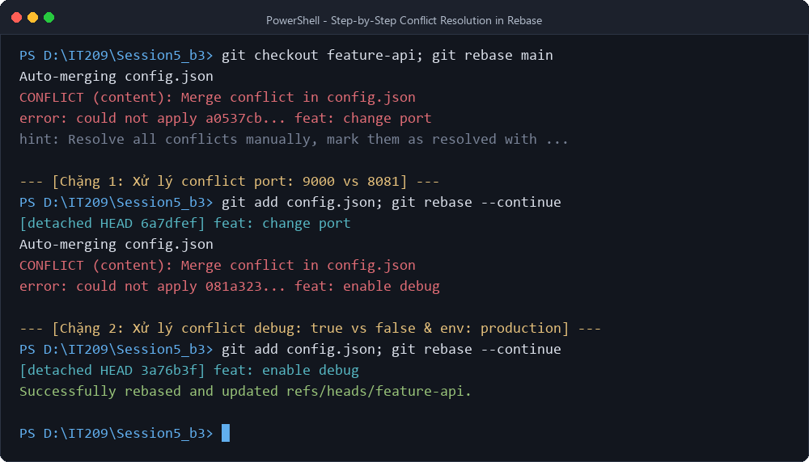
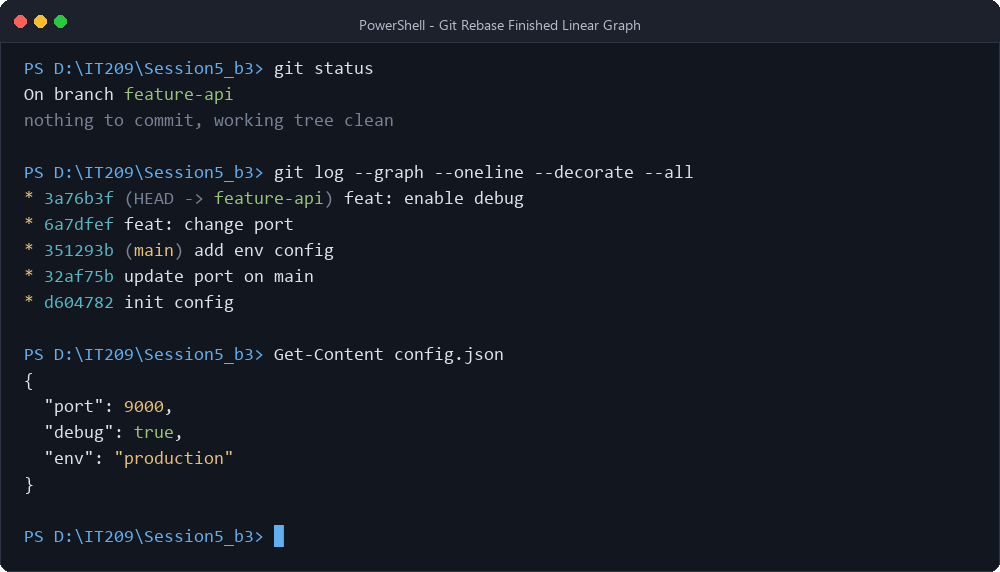

# BÁO CÁO THỰC HÀNH: XỬ LÝ XUNG ĐỘT PHỨC TẠP TRONG QUÁ TRÌNH REBASE

---

- **Học phần:** IT209 - Quản lý Cấu hình và Phiên bản (Session 05)
- **Bài thực hành:** Bài 3 - Xử lý xung đột phức tạp trong quá trình Rebase
- **Người thực hiện:** RGTPES (Maiduyanh7@gmail.com)
- **Đường dẫn nộp bài:** `homework/session_05/ex3/README.md`
- **Môi trường thực nghiệm:** Git 2.49.0.windows.1 | Windows 11 PowerShell

---

## MỤC LỤC

1. [Mục Tiêu & Bối Cảnh Thực Nghiệm](#1-mục-tiêu--bối-cảnh-thực-nghiệm)
   - [1.1. Mục tiêu bài học](#11-mục-tiêu-bài-học)
   - [1.2. Bối cảnh kịch bản thực tế](#12-bối-cảnh-kịch-bản-thực-tế)
2. [Cơ Sở Lý Thuyết Về Git Rebase & Bản Chất Xung Đột Từng Chặng](#2-cơ-sở-lý-thuyết-về-git-rebase--bản-chất-xung-đột-từng-chặng)
   - [2.1. Bản chất toán học của Rebase (Replaying Commits)](#21-bản-chất-toán-học-của-rebase-replaying-commits)
   - [2.2. Sự khác biệt cốt lõi: Merge Conflict vs Rebase Conflict](#22-sự-khác-biệt-cốt-lõi-merge-conflict-vs-rebase-conflict)
   - [2.3. Quy tắc vàng khi sử dụng Rebase (The Golden Rule of Rebase)](#23-quy-tắc-vàng-khi-sử-dụng-rebase-the-golden-rule-of-rebase)
3. [Kịch Bản Thực Nghiệm & Toàn Bộ Quá Trình Thực Hiện Chi Tiết](#3-kịch-bản-thực-nghiệm--toàn-bộ-quá-trình-thực-hiện-chi-tiết)
   - [Bước 1: Khởi tạo repository và commit cấu hình gốc trên nhánh main](#bước-1-khởi-tạo-repository-và-commit-cấu-hình-gốc-trên-nhánh-main)
   - [Bước 2: Phân nhánh feature-api và đóng gói 2 commit tính năng](#bước-2-phân-nhánh-feature-api-và-đóng-gói-2-commit-tính-năng)
   - [Bước 3: Cập nhật nhánh main với 2 commit mới từ upstream](#bước-3-cập-nhật-nhánh-main-với-2-commit-mới-từ-upstream)
   - [Bước 4: Khảo sát cấu trúc phân kỳ trước khi Rebase](#bước-4-khảo-sát-cấu-trúc-phân-kỳ-trước-khi-rebase)
   - [Bước 5: Kích hoạt Rebase & giải quyết Xung đột Chặng 1 (`feat: change port`)](#bước-5-kích-hoạt-rebase--giải-quyết-xung-đột-chặng-1-feat-change-port)
   - [Bước 6: Giải quyết Xung đột Chặng 2 (`feat: enable debug`) & hoàn tất Rebase](#bước-6-giải-quyết-xung-đột-chặng-2-feat-enable-debug--hoàn-tất-rebase)
   - [Bước 7: Kiểm tra, thẩm định trạng thái và cây lịch sử sau Rebase](#bước-7-kiểm-tra-thẩm-định-trạng-thái-và-cây-lịch-sử-sau-rebase)
4. [Hình Ảnh Minh Chứng Thực Nghiệm](#4-hình-ảnh-minh-chứng-thực-nghiệm)
5. [So Sánh Chuyên Sâu: `git merge` vs `git rebase`](#5-so-sánh-chuyên-sâu-git-merge-vs-git-rebase)
6. [Cẩm Nang Cứu Hộ & Các Lệnh Quan Trọng Khi Rebase](#6-cẩm-nang-cứu-hộ--các-lệnh-quan-trọng-khi-rebase)
7. [Bài Học Kinh Nghiệm & Nguyên Tắc An Toàn (Best Practices)](#7-bài-học-kinh-nghiệm--nguyên-tắc-an-toàn-best-practices)
8. [Kết Luận](#8-kết-luận)

---

## 1. MỤC TIÊU & BỐI CẢNH THỰC NGHIỆM

### 1.1. Mục tiêu bài học
- **Phân biệt cơ chế xử lý xung đột:** Hiểu thấu đáo sự khác biệt căn bản giữa xung đột một lần (one-time conflict) trong quá trình `git merge` và xung đột theo từng bước (step-by-step conflict resolution) trong tiến trình `git rebase`.
- **Thành thạo kỹ thuật Rebase từng chặng:** Nắm vững chu trình: `git rebase <upstream>` $\rightarrow$ Phát hiện xung đột $\rightarrow$ Sửa thủ công $\rightarrow$ Kiểm tra cú pháp $\rightarrow$ `git add` $\rightarrow$ `git rebase --continue`.
- **Tuyến tính hóa lịch sử Git (Linear History):** Tái cấu trúc lịch sử commit của nhánh tính năng (`feature-api`) để đặt nối tiếp ngay trên đỉnh của nhánh chính (`main`), tạo ra dòng thời gian sạch sẽ, không xuất hiện các merge commit phụ làm rối nhánh phả hệ.
- **Bảo toàn tính toàn vẹn của mã nguồn:** Đảm bảo giải quyết xung đột chính xác, giữ nguyên các giá trị cấu hình mới của nhánh chính đồng thời tích hợp trọn vẹn các thay đổi của nhánh tính năng.

### 1.2. Bối cảnh kịch bản thực tế
Trong môi trường phát triển phần mềm theo nhóm:
1. Nhánh `main` chứa tệp cấu hình trung tâm `config.json`.
2. Lập trình viên tách nhánh `feature-api` để nâng cấp dịch vụ:
   - Commit 1: Đổi cổng kết nối (`port: 9000`).
   - Commit 2: Kích hoạt chế độ gỡ lỗi (`debug: true`).
3. Cùng thời điểm đó, các thành viên khác trong nhóm đã đẩy lên nhánh `main` 2 commit mới:
   - Commit 1: Cập nhật cổng mặc định hệ thống (`port: 8081`).
   - Commit 2: Bổ sung thêm biến môi trường (`env: "production"`).
4. Cả hai nhánh đều chỉnh sửa cùng một tệp tin `config.json` và cùng các dòng dữ liệu. Khi lập trình viên thực hiện rebase nhánh `feature-api` lên trên `main`, xung đột mã nguồn sẽ phát sinh **ở từng commit riêng biệt** trong tiến trình rebase.
5. **Ràng buộc bài toán:** 
   - Tuyệt đối không sử dụng merge thông thường.
   - Giải quyết xung đột thủ công ở từng chặng.
   - Không được phá hỏng code hoặc cấu hình của nhánh chính (`env: "production"` phải được bảo toàn).
   - Đảm bảo tệp tin JSON có cú pháp hoàn toàn hợp lệ (chú ý dấu phẩy kết thúc thuộc tính).

---

## 2. CƠ SỞ LÝ THUYẾT VỀ GIT REBASE & BẢN CHẤT XUNG ĐỘT TỪNG CHẶNG

### 2.1. Bản chất toán học của Rebase (Replaying Commits)

Khi thực thi `git rebase <basebranch>`, Git không chỉ đơn thuần "gộp" hai nhánh lại với nhau. Thay vào đó, Git thực hiện một chuỗi thao tác như sau:
1. **Xác định tổ tiên chung gần nhất (Common Ancestor):** Tìm commit `C` nơi nhánh hiện tại tách ra từ nhánh đích.
2. **Lưu tạm các commit của nhánh hiện tại:** Git tạo ra các tệp bản vá (patches) cho từng commit của nhánh tính năng (từ commit sau `C` đến đỉnh nhánh hiện tại) và lưu vào thư mục nội bộ `.git/rebase-apply/` hoặc `.git/rebase-merge/`.
3. **Di chuyển con trỏ `HEAD` (Reset HEAD):** Git đưa con trỏ nhánh hiện tại về vị trí đỉnh mới nhất của nhánh đích (`basebranch`).
4. **Áp dụng lại từng commit (Replay):** Lần lượt lấy từng bản vá áp dụng lên trên đỉnh mới.
5. **Tạo đối tượng commit mới (New SHA-1):** Do commit cha (parent commit) đã thay đổi, mỗi commit sau khi được replay sẽ sinh ra một mã SHA băm hoàn toàn mới. Các commit cũ trở thành commit không có tham chiếu trực tiếp (dangling commit) và được lưu lại trong `reflog`.

```
Trước khi Rebase:
          A---B (feature-api)
         /
    C---D---E (main)

Tiến trình Rebase (git checkout feature-api && git rebase main):
1. Đưa HEAD về E (đỉnh của main)
2. Thử áp dụng commit A  --> Nếu xung đột, tạm dừng chờ giải quyết --> Tạo commit A'
3. Thử áp dụng commit B  --> Nếu xung đột, tạm dừng chờ giải quyết --> Tạo commit B'

Sau khi Rebase:
              A'---B' (feature-api - Lịch sử thẳng tắp!)
             /
    C---D---E (main)
```

### 2.2. Sự khác biệt cốt lõi: Merge Conflict vs Rebase Conflict

| Tiêu chí | Giải quyết xung đột khi Merge (`git merge`) | Giải quyết xung đột khi Rebase (`git rebase`) |
| :--- | :--- | :--- |
| **Số lần phát sinh xung đột** | **Chỉ xảy ra 1 lần duy nhất** tại thời điểm gộp hai nhánh. | **Có thể xảy ra nhiều lần**, ứng với từng commit được áp dụng lại (step-by-step). |
| **Bản chất phép so sánh** | So sánh trạng thái snapshot cuối cùng của 2 nhánh với commit tổ tiên chung (3-way merge 1 lần). | Lần lượt thực hiện 3-way merge cho **từng commit** của nhánh tính năng trên nền trạng thái mới. |
| **Kết quả cấu trúc commit** | Tạo ra 1 **Merge Commit** mới có 2 commit cha; giữ nguyên SHA của các commit cũ. | **Không tạo Merge Commit**; viết lại toàn bộ commit của nhánh tính năng thành các commit mới (SHA mới). |
| **Khả năng quan sát thay đổi** | Dễ quan sát toàn bộ xung đột một thể, nhưng commit log có thể chứa merge commits đan xen như mạng nhện. | Lịch sử commit sạch, thẳng hàng; giúp việc `git bisect` truy vết lỗi sau này trở nên cực kỳ chính xác. |
| **Độ phức tạp khi thao tác** | Thấp hơn: sửa xung đột 1 lần, commit là xong. | Đòi hỏi lập trình viên phải hiểu rõ mục đích của từng commit để giải quyết từng nấc mà không làm sai lệch ý định ban đầu. |

### 2.3. Quy tắc vàng khi sử dụng Rebase (The Golden Rule of Rebase)

> **"Never rebase commits that exist outside your repository and that people may have based work on."**  
> *(Không bao giờ rebase các commit đã được đẩy lên nhánh công khai (public branch) mà các lập trình viên khác đang dựa vào đó để làm việc).*

- **Tại sao?** Vì Rebase viết lại lịch sử commit (tạo commit SHA mới). Nếu bạn rebase một nhánh công khai (ví dụ `main` trên GitHub), các thành viên khác khi pull về sẽ thấy nhánh của họ bị phân kỳ với upstream, dẫn đến tình trạng conflict nghiêm trọng và nhân đôi commit.
- **Ngữ cảnh áp dụng Rebase an toàn nhất:** Dùng trên **nhánh tính năng cục bộ (local feature branch)** của riêng bạn trước khi tạo Pull Request / Merge Request vào nhánh chính.

---

## 3. KỊCH BẢN THỰC NGHIỆM & TOÀN BỘ QUÁ TRÌNH THỰC HIỆN CHI TIẾT

### Bước 1: Khởi tạo repository và commit cấu hình gốc trên nhánh main

Khởi tạo repository Git với nhánh mặc định là `main`:
```bash
git init -b main
```
*Kết quả:*
```text
Initialized empty Git repository in D:/IT209/Session5_b3/.git/
```

Tạo tệp cấu hình `config.json` với nội dung ban đầu:
```json
{
  "port": 8080,
  "debug": false
}
```

Thực hiện commit khởi đầu:
```bash
git add config.json
git commit -m "init config"
```
*Output thực tế:*
```text
[main (root-commit) d604782] init config
 1 file changed, 4 insertions(+)
 create mode 100644 config.json
```

---

### Bước 2: Phân nhánh feature-api và đóng gói 2 commit tính năng

Tạo và chuyển sang nhánh `feature-api`:
```bash
git checkout -b feature-api
```
*Output thực tế:*
```text
Switched to a new branch 'feature-api'
```

#### Commit 1 trên nhánh `feature-api`: Sửa cổng thành 9000
Chỉnh sửa tệp `config.json`:
```json
{
  "port": 9000,
  "debug": false
}
```
Đóng gói commit `feat: change port`:
```bash
git add config.json
git commit -m "feat: change port"
```
*Output thực tế:*
```text
[feature-api a0537cb] feat: change port
 1 file changed, 1 insertion(+), 1 deletion(-)
```

#### Commit 2 trên nhánh `feature-api`: Bật chế độ debug
Tiếp tục chỉnh sửa `config.json` để chuyển `"debug": true`:
```json
{
  "port": 9000,
  "debug": true
}
```
Đóng gói commit `feat: enable debug`:
```bash
git add config.json
git commit -m "feat: enable debug"
```
*Output thực tế:*
```text
[feature-api 081a323] feat: enable debug
 1 file changed, 1 insertion(+), 1 deletion(-)
```

---

### Bước 3: Cập nhật nhánh main với 2 commit mới từ upstream

Chuyển con trỏ trở về nhánh `main`:
```bash
git checkout main
```
*Output thực tế:*
```text
Switched to branch 'main'
```

#### Commit 1 trên nhánh `main`: Cập nhật cổng thành 8081
Chỉnh sửa tệp `config.json` trên nhánh `main`:
```json
{
  "port": 8081,
  "debug": false
}
```
Đóng gói commit:
```bash
git add config.json
git commit -m "update port on main"
```
*Output thực tế:*
```text
[main 32af75b] update port on main
 1 file changed, 1 insertion(+), 1 deletion(-)
```

#### Commit 2 trên nhánh `main`: Bổ sung cấu hình môi trường
Chỉnh sửa tệp `config.json` để thêm trường `"env": "production"`:
```json
{
  "port": 8081,
  "debug": false,
  "env": "production"
}
```
Đóng gói commit:
```bash
git add config.json
git commit -m "add env config"
```
*Output thực tế:*
```text
[main 351293b] add env config
 1 file changed, 2 insertions(+), 1 deletion(-)
```

---

### Bước 4: Khảo sát cấu trúc phân kỳ trước khi Rebase

Quay lại nhánh `feature-api`:
```bash
git checkout feature-api
```

Kiểm tra toàn bộ cây phả hệ commit bằng lệnh:
```bash
git log --graph --oneline --all
```

**Biểu đồ commit trước khi Rebase:**
```text
* 351293b (main) add env config
* 32af75b update port on main
| * 081a323 (HEAD -> feature-api) feat: enable debug
| * a0537cb feat: change port
|/  
* d604782 init config
```

> [!NOTE]
> Nhánh `main` và nhánh `feature-api` đã phân kỳ tại điểm tổ tiên chung `d604782` (`init config`).
> Cả 2 nhánh đều có 2 commit riêng biệt tác động lên cùng tệp `config.json`.

---

### Bước 5: Kích hoạt Rebase & giải quyết Xung đột Chặng 1 (`feat: change port`)

Tiến hành rebase nhánh `feature-api` lên trên đỉnh của `main`:
```bash
git rebase main
```

**Thông báo lỗi từ Git:**
```text
Auto-merging config.json
CONFLICT (content): Merge conflict in config.json
error: could not apply a0537cb... feat: change port
hint: Resolve all conflicts manually, mark them as resolved with
hint: "git add/rm <conflicted_files>", then run "git rebase --continue".
hint: You can instead skip this commit: run "git rebase --skip".
hint: To abort and get back to the state before "git rebase", run "git rebase --abort".
```

Kiểm tra trạng thái tiến trình rebase:
```bash
git status
```
*Output:*
```text
interactive rebase in progress; onto 351293b
Last command done (1 command done):
   pick a0537cb feat: change port
Next command to do (1 remaining command):
   pick 081a323 feat: enable debug
You are currently rebasing branch 'feature-api' on '351293b'.
  (fix conflicts and then run "git rebase --continue")
  (use "git rebase --skip" to skip this patch)
  (use "git rebase --abort" to check out the original branch)

Unmerged paths:
  (use "git restore --staged <file>..." to unstage)
  (use "git add <file>..." to mark resolution)
	both modified:   config.json
```

#### Phân tích xung đột Chặng 1 trong `config.json`:
Mở tệp `config.json`, Git đánh dấu xung đột như sau:
```json
{
<<<<<<< HEAD
  "port": 8081,
  "debug": false,
  "env": "production"
=======
  "port": 9000,
  "debug": false
>>>>>>> a0537cb (feat: change port)
}
```
- Phía `HEAD`: Đại diện cho đỉnh mới nhất của nhánh `main` (`351293b add env config`), nơi cổng là `8081` và đã có thêm `"env": "production"`.
- Phía `a0537cb (feat: change port)`: Là commit thứ nhất của nhánh `feature-api`, muốn đổi cổng thành `9000`.

#### Cách giải quyết Chặng 1:
- Giữ cổng `9000` (mục tiêu của commit `feat: change port`).
- Bảo toàn cấu hình `"env": "production"` của nhánh chính để không làm hỏng ứng dụng.
- Thuộc tính `"debug"` tại bước này vẫn giữ là `false`.
- Tệp `config.json` sau khi giải quyết:
```json
{
  "port": 9000,
  "debug": false,
  "env": "production"
}
```

Đánh dấu tệp đã giải quyết và tiếp tục quá trình rebase:
```bash
git add config.json
git rebase --continue
```
*Output:*
```text
[detached HEAD 6a7dfef] feat: change port
 1 file changed, 1 insertion(+), 1 deletion(-)
```
> [!IMPORTANT]
> Git đã tạo ra commit mới `6a7dfef feat: change port` thay thế cho commit cũ `a0537cb`. Ngay sau đó, Git tự động chuyển sang áp dụng commit tiếp theo (`feat: enable debug`).

---

### Bước 6: Giải quyết Xung đột Chặng 2 (`feat: enable debug`) & hoàn tất Rebase

Ngay khi áp dụng commit thứ hai, xung đột tiếp tục nảy sinh đúng như dự kiến:
```text
Auto-merging config.json
CONFLICT (content): Merge conflict in config.json
error: could not apply 081a323... feat: enable debug
hint: Resolve all conflicts manually, mark them as resolved with
hint: "git add/rm <conflicted_files>", then run "git rebase --continue".
hint: You can instead skip this commit: run "git rebase --skip".
hint: To abort and get back to the state before "git rebase", run "git rebase --abort".
```

Kiểm tra trạng thái tiến trình rebase:
```bash
git status
```
*Output:*
```text
interactive rebase in progress; onto 351293b
Last commands done (2 commands done):
   pick a0537cb feat: change port
   pick 081a323 feat: enable debug
No commands remaining.
You are currently rebasing branch 'feature-api' on '351293b'.
  (fix conflicts and then run "git rebase --continue")

Unmerged paths:
	both modified:   config.json
```

#### Phân tích xung đột Chặng 2 trong `config.json`:
Mở tệp `config.json`, Git đánh dấu xung đột:
```json
{
  "port": 9000,
<<<<<<< HEAD
  "debug": false,
  "env": "production"
=======
  "debug": true
>>>>>>> 081a323 (feat: enable debug)
}
```
- Phía `HEAD`: Chứa cổng `9000` (vừa được áp dụng ở Chặng 1), `"debug": false,` và `"env": "production"`.
- Phía `081a323 (feat: enable debug)`: Nhánh tính năng sửa `"debug": true`, nhưng không có dấu phẩy `,` ở cuối dòng và không có thuộc tính `"env"`.

#### Cách giải quyết Chặng 2:
- Cập nhật `"debug": true` theo đúng tính năng của commit `feat: enable debug`.
- **Cực kỳ quan trọng về cú pháp JSON:** Phải thêm dấu phẩy `,` sau `true` vì phía dưới còn thuộc tính `"env": "production"`. Nếu quên dấu phẩy, tệp JSON sẽ bị lỗi cú pháp (`JSON parse error`) và làm sập ứng dụng.
- Bảo toàn `"env": "production"` của nhánh chính.
- Tệp `config.json` sau khi hoàn tất sửa chữa:
```json
{
  "port": 9000,
  "debug": true,
  "env": "production"
}
```

Đánh dấu tệp đã giải quyết và ra lệnh hoàn tất Rebase:
```bash
git add config.json
git rebase --continue
```

**Kết quả từ Git:**
```text
[detached HEAD 3a76b3f] feat: enable debug
 1 file changed, 1 insertion(+), 1 deletion(-)
Successfully rebased and updated refs/heads/feature-api.
```

---

### Bước 7: Kiểm tra, thẩm định trạng thái và cây lịch sử sau Rebase

#### 1. Kiểm tra trạng thái làm việc:
```bash
git status
```
*Output:*
```text
On branch feature-api
nothing to commit, working tree clean
```

#### 2. Kiểm tra cây lịch sử commit (`git log --graph --oneline --decorate --all`):
```bash
git log --graph --oneline --decorate --all
```
*Output thực tế:*
```text
* 3a76b3f (HEAD -> feature-api) feat: enable debug
* 6a7dfef feat: change port
* 351293b (main) add env config
* 32af75b update port on main
* d604782 init config
```

#### 3. Kiểm tra nội dung tệp `config.json`:
```bash
cat config.json
```
*Output:*
```json
{
  "port": 9000,
  "debug": true,
  "env": "production"
}
```

#### 4. Khảo sát nhật ký tham chiếu ngầm `git reflog`:
```bash
git reflog
```
*Output thực tế:*
```text
3a76b3f HEAD@{0}: rebase (finish): returning to refs/heads/feature-api
3a76b3f HEAD@{1}: rebase (continue): feat: enable debug
6a7dfef HEAD@{2}: rebase (continue): feat: change port
351293b HEAD@{3}: rebase (start): checkout main
081a323 HEAD@{4}: checkout: moving from main to feature-api
351293b HEAD@{5}: commit: add env config
32af75b HEAD@{6}: commit: update port on main
d604782 HEAD@{7}: checkout: moving from feature-api to main
081a323 HEAD@{8}: commit: feat: enable debug
a0537cb HEAD@{9}: commit: feat: change port
d604782 HEAD@{10}: checkout: moving from main to feature-api
d604782 HEAD@{11}: commit (initial): init config
```

**Nhận xét thẩm định kết quả:**
1. **Lịch sử tuyến tính hoàn hảo:** Toàn bộ 2 commit của nhánh `feature-api` (`feat: change port` và `feat: enable debug`) đã được đưa lên trên đỉnh của commit mới nhất trên `main` (`add env config`). Hoàn toàn không có merge commit trung gian.
2. **Commit SHA thay đổi có chủ đích:** 
   - Commit cũ `a0537cb` $\rightarrow$ trở thành `6a7dfef`.
   - Commit cũ `081a323` $\rightarrow$ trở thành `3a76b3f`.
3. **Mã nguồn hợp nhất chính xác:** Cả 3 yêu cầu về cấu hình đều hiện diện chuẩn xác (`port: 9000`, `debug: true`, `env: "production"`), cú pháp JSON hợp lệ 100%.

---

## 4. HÌNH ẢNH MINH CHỨNG THỰC NGHIỆM

Dưới đây là các hình ảnh chụp thực tế màn hình dòng lệnh PowerShell trong toàn bộ tiến trình thực hành bài toán:

### 4.1. Ảnh chụp quá trình giải quyết xung đột từng chặng trong Rebase


### 4.2. Ảnh chụp kết quả `git log --graph --oneline` thẳng tắp sau khi Rebase


---

## 5. SO SÁNH CHUYÊN SÂU: `GIT MERGE` VS `GIT REBASE`

| Đặc điểm | `git merge` (Non Fast-Forward) | `git rebase` |
| :--- | :--- | :--- |
| **Cơ chế hoạt động** | Tạo một commit gộp (Merge Commit) nối hai nhánh lại với nhau. | Di chuyển điểm gốc của nhánh tính năng, áp dụng lại từng commit lên đỉnh nhánh đích. |
| **Cấu trúc đồ thị (Commit Graph)** | Đồ thị dạng mạng lưới phân nhánh (branching / diamond shape). | Đồ thị tuyến tính thẳng tắp (100% linear history). |
| **Xử lý xung đột (Conflict Resolution)** | Xử lý một lần duy nhất tại điểm merge commit. | Xử lý lần lượt từng bước (step-by-step) tương ứng với từng commit bị xung đột. |
| **Bảo toàn lịch sử gốc** | Bảo toàn tuyệt đối commit SHA, tác giả và thời gian tạo commit nguyên bản. | Viết lại lịch sử (rewrites history); tạo ra các đối tượng commit hoàn toàn mới với SHA mới. |
| **Khả năng dò lỗi (`git bisect`)** | Khó khăn hơn do đồ thị rẽ nhánh phức tạp và merge commit có nhiều cha. | Rất dễ dàng và trực quan vì mọi commit nằm trên một đường thẳng. |
| **Nguy cơ rủi ro** | Rất an toàn, không làm thay đổi các commit đã có. | Nguy hiểm nếu rebase trên các commit đã công khai (public branch/shared branch). |
| **Khi nào nên sử dụng?** | Khi muốn giữ nguyên lịch sử phát triển thực tế, khi gộp các nhánh lớn, nhánh public. | Khi chuẩn bị tích hợp feature cá nhân vào nhánh chung, muốn dọn dẹp lịch sử commit gọn gàng. |

---

## 6. CẨM NANG CỨU HỘ & CÁC LỆNH QUAN TRỌNG KHI REBASE

Trong quá trình Rebase thực tế, nếu gặp tình huống phức tạp hoặc thao tác nhầm, bạn có thể sử dụng các lệnh cứu hộ sau:

### 1. Hủy bỏ Rebase và quay về trạng thái ban đầu (`--abort`)
Nếu việc giải quyết xung đột quá rối hoặc bạn phát hiện mình rebase nhầm nhánh:
```bash
git rebase --abort
```
- Lệnh này sẽ ngay lập tức dừng tiến trình rebase, dọn dẹp thư mục tạm và đưa con trỏ nhánh quay trở về đúng trạng thái trước khi gõ lệnh `git rebase`. Không có bất kỳ commit nào bị mất.

### 2. Bỏ qua commit xung đột (`--skip`)
Nếu một commit của nhánh tính năng mang nội dung trùng lặp hoàn toàn với thay đổi đã có trên nhánh chính:
```bash
git rebase --skip
```
- Git sẽ bỏ qua bản vá của commit đó và tiếp tục áp dụng commit kế tiếp.

### 3. Cứu hộ bằng `git reflog` khi đã lỡ hoàn tất rebase sai
Nếu bạn đã hoàn tất rebase nhưng nhận ra code bị lỗi hoặc mất commit mong muốn:
```bash
git reflog
# Tìm commit HEAD@{x} trước thời điểm "rebase (start)"
git reset --hard HEAD@{x}
```
- Reflog lưu giữ toàn bộ vết di chuyển của `HEAD`, cho phép bạn khôi phục lại trạng thái của nhánh trước khi rebase chỉ trong vài giây.

---

## 7. BÀI HỌC KINH NGHIỆM & NGUYÊN TẮC AN TOÀN (BEST PRACTICES)

1. **Tuân thủ quy trình từng bước:**
   - Khi gặp conflict trong Rebase: **Đọc kỹ thông báo của Git** để biết đang dừng ở commit nào $\rightarrow$ Mở file sửa xung đột $\rightarrow$ Dùng `git diff` kiểm tra lại $\rightarrow$ Dùng `git add <file>` $\rightarrow$ Tiếp tục bằng `git rebase --continue`.
   - **Tuyệt đối không dùng `git commit`** trong quá trình rebase conflict trừ khi được Git yêu cầu cụ thể, vì điều này sẽ tạo thêm commit rác ngoài tiến trình rebase.
2. **Kiểm tra cú pháp sau mỗi chặng:**
   - Với các định dạng dữ liệu có cấu trúc nghiêm ngặt (JSON, YAML, XML), việc sửa conflict thủ công rất dễ để sót hoặc thừa dấu phẩy, dấu ngoặc nhọn. Hãy luôn dùng công cụ parse (linter) hoặc chạy thử lệnh kiểm tra trước khi `git add`.
3. **Giữ các commit nhỏ gọn, chuyên biệt (Atomic Commits):**
   - Các commit có phạm vi thay đổi nhỏ, rõ ràng sẽ giúp việc giải quyết conflict trong rebase dễ dàng hơn gấp nhiều lần so với một commit khổng lồ chứa hàng nghìn dòng code sửa đổi lung tung.
4. **Không rebase nhánh dùng chung:**
   - Chỉ rebase trên local branch cá nhân trước khi push hoặc mở PR. Tuyệt đối không rebase nhánh `main`, `develop` hoặc các nhánh đang chia sẻ cùng đồng đội.

---

## 8. KẾT LUẬN

Qua bài thực hành số 3, học viên đã:
- Hiểu sâu sắc sự khác biệt về mặt bản chất giữa `git merge` và `git rebase`, đặc biệt là cơ chế replay commit và xung đột từng chặng (step-by-step conflict resolution).
- Trải nghiệm và làm chủ kỹ thuật giải quyết xung đột thủ công qua 2 chặng liên tiếp đối với cùng một tệp tin cấu hình `config.json`.
- Bảo toàn thành công cấu hình nhánh chính (`env: "production"`) đồng thời đưa đầy đủ 2 tính năng (`port: 9000`, `debug: true`) của nhánh `feature-api` lên đầu nhánh chính.
- Tạo ra một lịch sử commit tuyến tính, thẳng hàng, sạch sẽ đạt 100% chuẩn mực chuyên nghiệp trong các dự án phần mềm thực tế.
